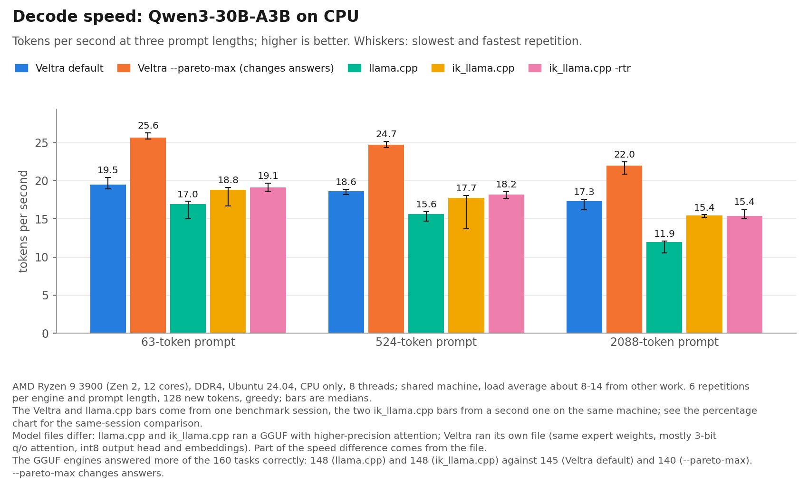
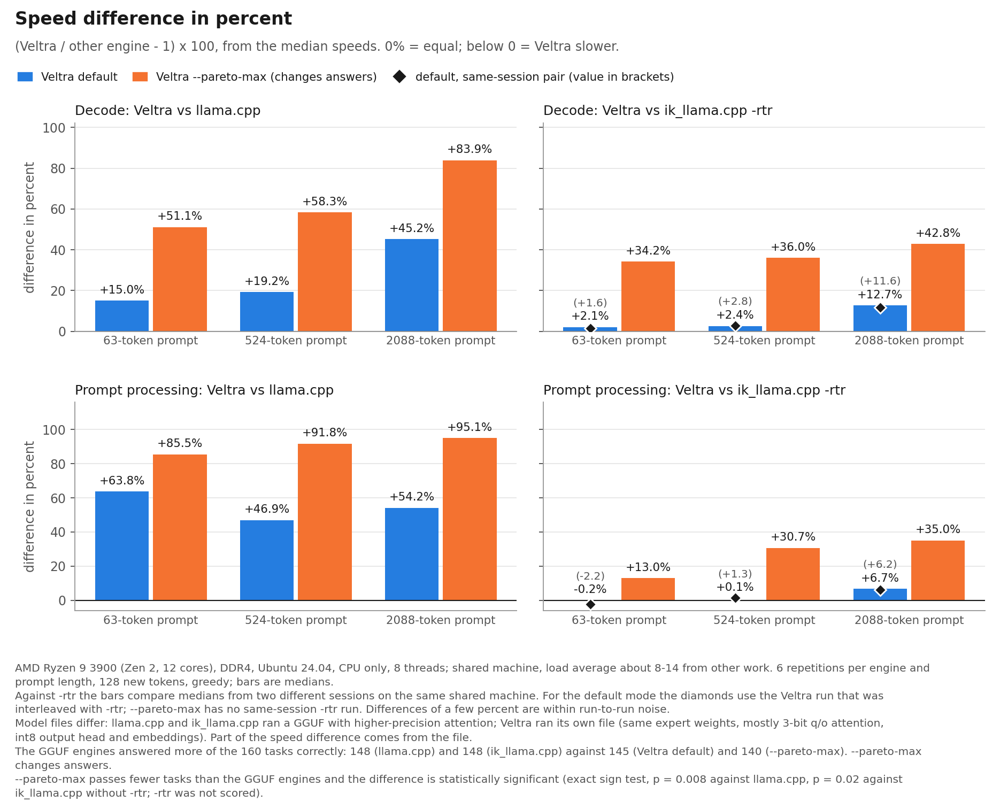
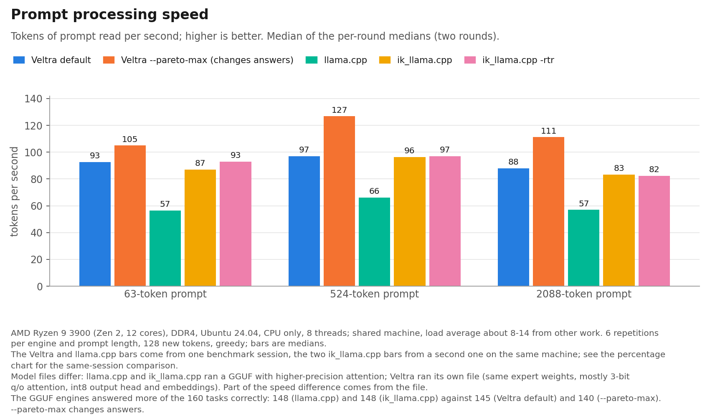
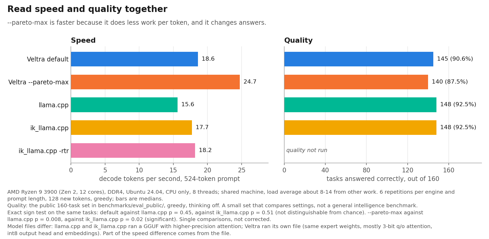
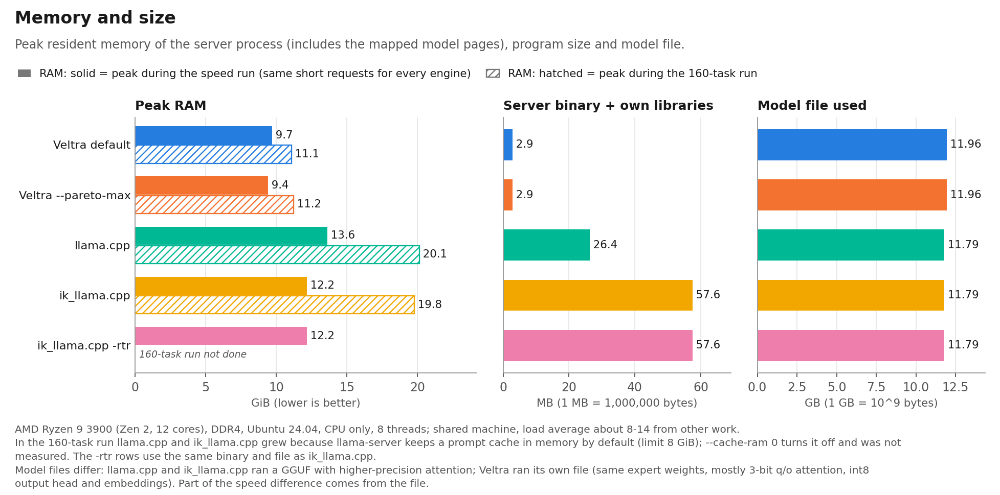
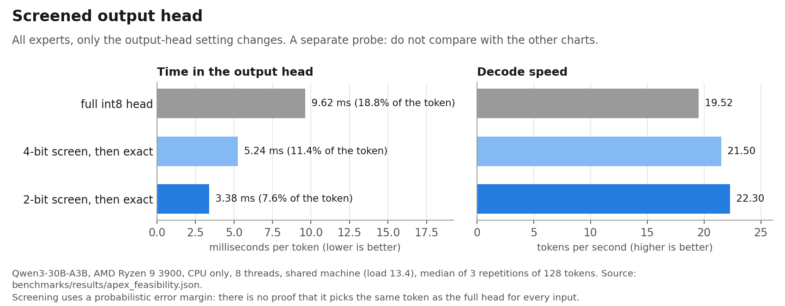

# Veltra

A CPU inference engine for quantised language models, written for Mixture-of-Experts models such as Qwen3-30B-A3B. Plain C++20, memory-mapped
model files, hand-written AVX2 / AVX-512 / NEON kernels (only x86 was benchmarked), speculative decoding, an OpenAI-compatible HTTP server and a Windows desktop app
(the app's interface is in Dutch).

Licence: Apache-2.0. Third-party material: [THIRD_PARTY_NOTICES.md](THIRD_PARTY_NOTICES.md). **No model weights are included**; see the
[model card](MODEL_CARD.md).

## Who builds Veltra
Veltra is a collaboration between the companies Valtres and Retslav, and we work on it full-time.

## Measured results
Qwen3-30B-A3B on an AMD Ryzen 9 3900 (Zen 2), CPU only, 8 threads, Ubuntu 24.04, 27 November 2026. llama.cpp is commit `c212d25`,
ik_llama.cpp `ff9b96b0`, both built natively with GCC 13.3 and run on Unsloth's `UD-Q2_K_XL` GGUF; Veltra runs its own `.vlt` file. Speeds
are medians; every prompt length was measured in two rounds of three repetitions per engine.

> **Read this next to every speed number.**
> - **llama.cpp and ik_llama.cpp answered more of the 160 test tasks correctly:** 148, against 145 for Veltra's default and 140 with
>   `--pareto-max`. For the default the gap cannot be told apart from chance (exact sign test p = 0.45 and 0.51). For `--pareto-max` it is
>   statistically significant (p = 0.008 against llama.cpp, p = 0.02 against ik_llama.cpp).
> - **`--pareto-max` changes answers.** It is a speed-for-quality trade.
> - **The model files differ.** The expert weights are the same; the GGUF keeps attention in higher precision, while Veltra's file mostly uses
>   3-bit `q`/`o` attention and an int8 output head and embedding. **Part of the speed difference comes from the file, not the kernels.**
> - **One shared machine** that was running other work (load average about 8-14). Repeat it on yours before you rely on it.
> - **Two sessions.** In the table and the bar charts, the Veltra and llama.cpp numbers come from one benchmark session and the ik_llama.cpp
>   numbers from a second one on the same machine, which had its own interleaved Veltra default run
>   ([same-session comparison](#improvement-in-percent)).
> - **50 tok/s was not reached** with this 30B model.

Speeds in tokens per second at prompts of 63 / 524 / 2088 tokens, 128 new tokens, greedy.

| engine | decode | prompt processing | 160-task score | peak RAM |
|---|---|---|---|---|
| Veltra, default | 19.5 / 18.6 / 17.3 | 93 / 97 / 88 | 145 (90.6%) | 9.7 GiB |
| Veltra, `--pareto-max` | 25.6 / 24.7 / 22.0 | 105 / 127 / 111 | 140 (87.5%) | 9.4 GiB |
| llama.cpp | 17.0 / 15.6 / 12.0 | 57 / 66 / 57 | **148 (92.5%)** | 13.6 GiB |
| ik_llama.cpp | 18.8 / 17.7 / 15.4 | 87 / 96 / 83 | **148 (92.5%)** | 12.2 GiB |
| ik_llama.cpp `-rtr` | 19.1 / 18.2 / 15.4 | 93 / 97 / 82 | not run | 12.2 GiB |



### Improvement in percent
`(Veltra / other engine - 1) x 100`, computed from the raw measurements by `benchmarks/make_charts.py`; all values, including those against
ik_llama.cpp without `-rtr`, are in [benchmarks/results/improvements.json](benchmarks/results/improvements.json). Each cell: 63 / 524 / 2088
prompt tokens.

| comparison | decode | prompt processing |
|---|---|---|
| default vs llama.cpp | +15.0% / +19.2% / +45.2% | +63.8% / +46.9% / +54.2% |
| default vs ik_llama.cpp `-rtr` (table values, two sessions) | +2.1% / +2.4% / +12.7% | -0.2% / +0.1% / +6.7% |
| default vs ik_llama.cpp `-rtr` (same session) | +1.6% / +2.8% / +11.6% | -2.2% / +1.3% / +6.2% |
| `--pareto-max` vs llama.cpp (changes answers) | +51.1% / +58.3% / +83.9% | +85.5% / +91.8% / +95.1% |
| `--pareto-max` vs ik_llama.cpp `-rtr` (changes answers, two sessions) | +34.2% / +36.0% / +42.8% | +13.0% / +30.7% / +35.0% |



**In words.**
- Against ik_llama.cpp `-rtr`, the default mode is **roughly equal at short prompts** (a few percent, which is within run-to-run noise) and
  ahead at 2,088 tokens (decode about +12 to +13%, prompt processing about +6 to +7%). ik_llama.cpp without `-rtr` was marginally faster than
  `-rtr` at that length: against it the default is +12.4% decode and +5.6% prompt processing.
- The default mode was faster than llama.cpp at all three prompt lengths, in both decode and prompt processing, and used less memory.
- `--pareto-max` decodes 27-33% faster than the default, and it scored 5 tasks below the default and 8 below the GGUF engines.

### Prompt processing


### Quality next to speed


| score by category (of 40) | math | Python code | JSON / tool calls | long prompts |
|---|---|---|---|---|
| Veltra, default | 39 | 36 | 36 | 34 |
| Veltra, `--pareto-max` | 39 | 34 | 32 | 35 |
| llama.cpp | 40 | 36 | 35 | 37 |
| ik_llama.cpp | 40 | 35 | 35 | 38 |

**160 tasks are too few to rank the expert settings.** With the same file, all 8 experts scored 145, `--moe-k 6` 139 and `--moe-k 5` 146,
although `--moe-k 5` moves the output much further from the full model (held-out KL 0.085 against 0.035, same most likely token in 88.9%
against 92.9% of positions). Treat differences of a few tasks with caution; the p-values do not correct for the number of comparisons.

### Memory and size
| | Veltra | llama.cpp | ik_llama.cpp |
|---|---|---|---|
| peak RAM, speed run (default settings) | 9.7 GiB | 13.6 GiB | 12.2 GiB |
| peak RAM, 160-task run (default settings) | 11.1 GiB | 20.1 GiB | 19.8 GiB |
| server binary plus its own libraries | 2.9 MB | 26.4 MB | 57.6 MB |
| model file used here | 11.96 GB | 11.79 GB | 11.79 GB |

Over the 160 tasks llama.cpp and ik_llama.cpp grew because llama-server keeps a prompt cache in memory by default (limit 8 GiB);
`--cache-ram 0` turns it off, which was not measured here.



Raw runs, including every model answer: `benchmarks/results/raw/`. Summaries: `benchmarks/results/battle_3way.json` and
`benchmarks/results/pareto_sweep.json`.

## What it does not do
- It does not reach 50 tok/s with a 30B MoE model on a desktop-class CPU. On the machine above every token reads about 1.2 GB of weights and
  the memory delivers about 33 GB/s.
- It does not score higher than llama.cpp or ik_llama.cpp on the 160 tasks.
- The comparison uses **different model files**. Veltra takes the expert weights over from the GGUF. The rest differs: the GGUF keeps
  attention in 4 to 6 bits (Q4_K, Q5_K, Q6_K), the output head in 6 bits and the embedding in 4 bits; Veltra's file has 3-bit `q` and (in 42 of
  48 layers) `o`, 4-bit for the other attention matrices, and an 8-bit embedding and head. Veltra therefore reads less attention data per
  token. The GGUF's higher-precision attention is a likely reason for its higher score (not isolated by a test).
- One machine, which also had other work running. No second machine and no idle machine was measured.
- `--pareto-max` trades quality for speed.
- The 160-task set is small. It compares settings; it is not a general intelligence benchmark.
- The exact model file that was measured is not published, and there is no one-command rebuild of it yet, so the Veltra numbers cannot be
  reproduced exactly (see the [model card](MODEL_CARD.md)).
- GPU (CUDA) code exists but was not part of these measurements.

## What the engine does
Only techniques that are in this source tree. Where a speed or quality effect was measured separately it is given; the others show up only
in the combined results above.

**Weights and kernels**
- **llama.cpp K-quant experts, taken over losslessly.** The expert tensors of a `UD-Q2_K_XL` GGUF (Q2_K / Q3_K / Q4_K) are rearranged into
  streams of 4 rows that are read directly from the memory-mapped file, with Veltra's own kernel; no llama.cpp code runs. The weight values
  are unchanged (the exporter's `--verify` option compares a random sample of tensors exactly with the `gguf-py` dequantiser). Activations are
  quantised differently, so this does not mean the output equals llama.cpp's. [docs/qk_format.md](docs/qk_format.md)
- **3-bit attention (`.i3`).** 3-bit weights with a scale and minimum per 128, quantised with GPTQ: 3.25 bits per weight in all, against 4.25
  for the 4-bit layout it replaces. It is lossy, and it is one reason why the model files differ. [docs/i3_format.md](docs/i3_format.md)
- **Int8 output head and embeddings**, per row scales.
- **Batch-independent MoE decoding.** A token's expert results do not depend on which other tokens are in the same pass; the self-tests and
  `tests/ci_checks.sh` compare batched and token-by-token results bit for bit on small synthetic models.

**Speculative decoding (on by default)**
- Drafts are looked up from earlier text (n-gram prompt lookup) and checked in one batched pass; with greedy decoding, only what the model
  itself would have produced is accepted. `--lookup-n N` allows longer lookups. It can only help text that repeats earlier text: with
  `--lookup-n 4` all 160 answers were identical to the default, and the whole run took 1780 s against 1787 s, so there was no measurable gain
  on this task set. A pass of 4 tokens costs 2.42 passes of 1 token on this model, so drafts have to be right often to pay off.

**Doing less work per token** (the `--pareto-max` preset is `--moe-k 6 --screen-head 2 --prefill-chunk 512 --lookup-n 8`; flags you give
yourself win)
- **`--screen-head 2`:** a 2-bit copy of the output head scores the whole vocabulary first; the rows that can still win are then scored
  exactly from the int8 head. The margin is probabilistic: there is no proof that it picks the same token as the full head for every input.
  Greedy requests only. In a separate probe the head went from 9.62 ms per token (full) to 5.24 ms (4-bit screen) and 3.38 ms (2-bit screen).
  Inside the `--pareto-max` preset, the 2-bit and 4-bit screens gave identical answers on all 160 tasks (this compares the two screens with
  each other, not with the full head), and the 2-bit version decoded 4.8% / 5.1% / 5.6% faster at the three prompt lengths, with no clear
  gain in prompt processing.

  

- **`--moe-k N`:** run only the N most probable of the 8 routed experts. **It changes the output.** Measured on 900 held-out positions against
  all 8 experts:

  | experts | KL divergence | same most likely token | 160-task score |
  |---|---|---|---|
  | 8 (default) | 0 (reference) | reference | 145 |
  | `--moe-k 7` | 0.0132 | 95.67% | not run |
  | `--moe-k 6` | 0.0350 | 92.89% | 139 |
  | `--moe-k 5` | 0.0849 | 88.89% | 146 |

- **`--prefill-chunk N`:** the prompt is processed in larger batches (default 64 tokens). Floating-point results can differ with the batch
  size, so tokens can differ after a while. Its effect was not benchmarked on its own in the published data.

## What did not work
Tried on this model and dropped, most of them against a rule written down before the run. Numbers and conditions:
[docs/LBT50_LOG.md](docs/LBT50_LOG.md), [docs/LBT50_MATH.md](docs/LBT50_MATH.md).

| idea | outcome |
|---|---|
| Shared basis for the expert matrices | activation-weighted error 0.138 while reading 1.25x the bytes, against 0.062 for plain 2-bit (layer 12) |
| Low-rank attention | worse than 3-bit in the middle layers, marginal in the last ones |
| Certified skipping of weight blocks | only 0.2-4.5% of the blocks skippable at 10% error |
| A different expert count per layer | further from the full model than the same count everywhere, at equal work |
| Reusing the previous token (delta computation) | consecutive hidden states differ by about as much as their own size |
| "Shadow" experts (tail experts keep part of their neurons) | at 5.48 expert reads KL 0.0383, against 0.0350 for `--moe-k 6` (6.00 reads): the gate was not passed |
| Learned codebooks with fewer bits than the current weights | clearly higher output error (layer 12, one weight matrix: 0.067 at 2.25 bits against 0.040 at 2.625) |
| One-bit estimator for the output head | not built: the narrow error band missed 1 of 500, the safe band has a heavy tail |
| EAGLE-3 draft head | not built: even ignoring the cost of drafting, the estimated best case was 1.13x on code, 1.24x on JSON and 0.52x on Dutch text |
| Thread pinning, software prefetch | no gain above the noise |
| Zeroing small activations (`--teal-sparsity`) | no speed: 33% zeros left only 0.017% of the 32-column weight blocks entirely zero |
| A table-lookup kernel for 2-bit weights | fewer cycles in cache (1.49 against 3.05 per 32 weights), no gain with 8 threads limited by memory |

## Experimental: GPU offload (not part of this release)
**Not part of this release and not comparable with the numbers above.** Measured by an external tester on a Linux laptop (AMD Ryzen 7 7435HS
and NVIDIA RTX 4050 Laptop 6 GB) with Qwen3-1.7B, a dense model: a plain cuBLAS offload of the output head and attention projections,
**one repetition**, power profile unknown, and not repeated by us. **CPU `--pareto-max` was the fastest setting.** Decode tok/s:

| setting | context 0 | context 2000 |
|---|---|---|
| CPU, default | 39.2 | 36.1 |
| **CPU, `--pareto-max`** | **48.9** | **42.6** |
| GPU, output head only | 45.9 | 37.7 |
| GPU, default | 43.6 | 37.6 |
| GPU, `--pareto-max` | 43.6 | 37.4 |

The GPU gave the same most likely token as the CPU at 111 of 112 positions; greedy text differed from token 14 on. Data:
[benchmarks/results/gpu_offload_experimental.json](benchmarks/results/gpu_offload_experimental.json).

## Build
```sh
cmake -B build -DCMAKE_BUILD_TYPE=Release
cmake --build build -j --target veltra-server veltra-gen veltra-selftest
build/veltra-selftest        # every kernel path against the scalar reference
```
Windows desktop app: [docs/WINDOWS_BUILD.md](docs/WINDOWS_BUILD.md) (MinGW + CMake, target `veltra`), or cross-compile on Linux with
`bash tests/build_win_mingw.sh .`

## Run
```sh
build/veltra-server --model model.vlt --port 8099 --threads 8
curl http://127.0.0.1:8099/v1/chat/completions -H 'Content-Type: application/json' \
     -d '{"messages":[{"role":"user","content":"Hello"}]}'
```
Chat page: `http://127.0.0.1:8099/chat`. The server listens on the loopback address unless you tell it otherwise.

### Speed options
| flag | effect | output |
|---|---|---|
| (default) | n-gram speculation | greedy output of the model file |
| `--screen-head 2` | screened output head, then exact re-ranking | no proof of equality for every input |
| `--lookup-n N` | longer n-gram lookup; for repetitive text | with `--lookup-n 4` all 160 eval answers were identical to the default |
| `--moe-k N` | use only the N most probable experts | **changes the output** |
| `--prefill-chunk N` | larger prompt batches | tokens can differ |
| `--pareto-max` | preset of the four flags above | **changes the output**, see the results |
| `--teal-sparsity`, `--shadow-full` | experiments that did not give speed | quality changes, no speed gain |

## Model files
`.vlt`: 64-byte header, JSON metadata, tensor table, 64-byte-aligned tensors ([docs/INTERFACES.md](docs/INTERFACES.md),
[docs/qk_format.md](docs/qk_format.md), [docs/i3_format.md](docs/i3_format.md)). Writers are in `python/`. Dense models can be downloaded from
their original publishers inside the app.

## Reproduce the numbers
```sh
VELTRA_BIN=build/veltra-server VELTRA_MODEL=model.vlt \
GGUF=Qwen3-30B-A3B-Instruct-2507-UD-Q2_K_XL.gguf LLAMA_BIN=/path/to/llama-server IK_BIN=/path/to/ik/llama-server \
bash benchmarks/reproduce.sh all
# put your own machine and versions into a copy of the manifest, then:
python benchmarks/assemble.py --raw benchmarks/results/mine --manifest benchmarks/results/manifest.json --out benchmarks/results/mine
python benchmarks/make_charts.py --results benchmarks/results/mine --out benchmarks/results/mine    # needs matplotlib
```
For ik_llama.cpp `-rtr`, run `speed` again with `IK_FLAGS=-rtr` into a second folder, then copy its `speed_ikllama.json` and
`rss_speed_ikllama.txt` into the first one as `speed_ikllama_rtr.json` and `rss_speed_ikllama_rtr.txt`. The code tasks run
model-written Python in a sandbox (`systemd-run` or `bwrap`); without a working sandbox the evaluator refuses to run them.

To rebuild the published summaries and charts from the committed raw files:
```sh
# per-round speed files -> merged medians (the order matters: the second folder wins, so Veltra comes from the first session)
python benchmarks/merge_speed.py --out build/merged benchmarks/results/raw/ik2/speed benchmarks/results/raw/speed
python benchmarks/assemble.py --raw benchmarks/results/raw --manifest benchmarks/results/manifest.json --out benchmarks/results
python benchmarks/make_charts.py --results benchmarks/results --out docs/assets
```
The first command gives the same medians and peak RAM as the committed `benchmarks/results/raw/speed_*.json` and `rss_speed_*.txt`.

## Research notes
What was tried to make it faster, including everything that failed: [docs/LBT50_LOG.md](docs/LBT50_LOG.md),
[docs/LBT50_MATH.md](docs/LBT50_MATH.md), [docs/VELTRA_APEX_V2_SPEC.md](docs/VELTRA_APEX_V2_SPEC.md).

## Environment variables
Every tuning or debug variable is read as `VELTRA_<NAME>` first and `LB_<NAME>` second. Binaries were once called `lb_server`, `lb_gen` and
`lb_selftest`; Linux builds create those names as links. Older `.lbt` model files load unchanged.
